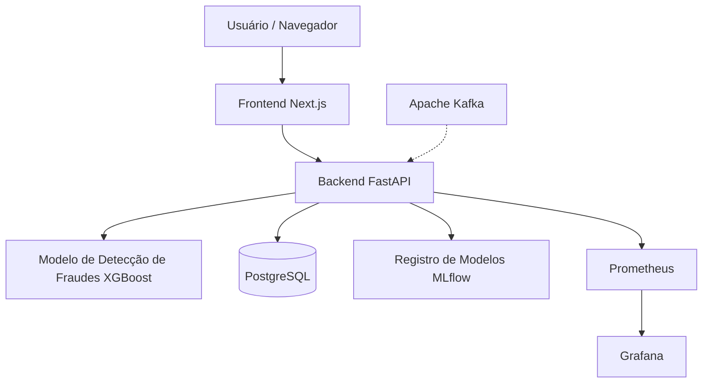

# FraudShield AI

### Sistema de Machine Learning de Ponta a Ponta para Detecção de Fraudes

O FraudShield AI é um projeto full-stack de Machine Learning desenvolvido para identificar transações financeiras potencialmente fraudulentas utilizando um modelo de classificação XGBoost.

O projeto demonstra a integração entre engenharia de Machine Learning, desenvolvimento backend, MLOps, persistência de dados, monitoramento e uma interface web moderna.

A aplicação é executada localmente utilizando Docker Compose, sem necessidade de implantação em nuvem.

## Principais Funcionalidades

- Previsão de fraudes utilizando XGBoost.
- API REST desenvolvida com FastAPI.
- Dashboard interativo desenvolvido com Next.js.
- PostgreSQL para armazenamento persistente de dados.
- Infraestrutura Apache Kafka para processamento orientado a eventos.
- MLflow para rastreamento de experimentos e registro de modelos.
- Prometheus e Grafana para observabilidade.
- Docker Compose para orquestração da infraestrutura local.
- Verificações automatizadas de qualidade utilizando GitHub Actions.

## Desempenho do Modelo de Machine Learning

A avaliação final apresentou os seguintes resultados:

| Métrica | Resultado |
|---|---|
| ROC-AUC | 0.9694 |
| Average Precision (PR-AUC) | 0.8398 |
| Precision | 0.8696 |
| Recall | 0.8108 |
| F1-Score | 0.8392 |

Os resultados da avaliação estão armazenados em `artifacts/experiments/final_evaluation.json`.

Essas métricas representam o desempenho do modelo nos dados de teste utilizados no projeto e não devem ser interpretadas como garantias de desempenho em produção.

## Arquitetura do Sistema



O Kafka faz parte da infraestrutura local para processamento orientado a eventos. O diagrama não significa que todas as requisições da API passem pelo Kafka.

## Tecnologias Utilizadas

| Camada | Tecnologias |
|---|---|
| Machine Learning | Python, XGBoost, scikit-learn |
| Backend | FastAPI, SQLAlchemy |
| Frontend | Next.js, React, TypeScript, Tailwind CSS |
| Banco de Dados | PostgreSQL |
| Processamento de Eventos | Apache Kafka |
| Rastreamento de Experimentos | MLflow |
| Monitoramento | Prometheus, Grafana |
| Infraestrutura | Docker, Docker Compose |
| Integração Contínua | GitHub Actions |

## Como Executar o Projeto

### Pré-requisitos

- Git
- Docker Desktop
- Docker Compose

### Clonar o repositório

```bash
git clone https://github.com/AlissonDiaspi/fraudshield-ai.git
cd fraudshield-ai
```

### Configurar as variáveis de ambiente

Crie um arquivo `.env` na raiz do projeto e configure as credenciais do PostgreSQL e do Grafana exigidas pelo `docker-compose.yml`.

Exemplo:

```env
POSTGRES_USER=fraudshield
POSTGRES_PASSWORD=substitua_por_uma_senha_local
POSTGRES_DB=fraudshield
GRAFANA_ADMIN_PASSWORD=substitua_por_outra_senha
```

Variáveis de ambiente adicionais podem ser necessárias para determinados componentes do projeto.

### Iniciar a infraestrutura

```bash
docker compose up -d --build
```

**Importante:** o serviço MLflow utiliza metadados de experimentos e artefatos de modelos armazenados localmente. Antes de executar previsões, certifique-se de que o modelo registrado com o alias `champion` e seus respectivos artefatos estejam disponíveis no armazenamento configurado do MLflow.

### Acessar os serviços

| Serviço | Endereço Local |
|---|---|
| Frontend | http://127.0.0.1:3001 |
| FastAPI Swagger | http://127.0.0.1:8000/docs |
| FastAPI Health | http://127.0.0.1:8000/health |
| MLflow | http://127.0.0.1:5000 |
| Prometheus | http://127.0.0.1:9090 |
| Grafana | http://127.0.0.1:3000 |

### Encerrar a aplicação

```bash
docker compose down
```

Os volumes persistentes do Docker são mantidos por padrão.

## Registro de Modelos

O FraudShield AI utiliza o MLflow para gerenciar diferentes versões dos modelos de Machine Learning.

O modelo principal atualmente configurado é:

- **Nome do modelo:** `FraudShield-FraudDetector`
- **Versão:** `1`
- **Alias:** `champion`
- **Algoritmo:** XGBoost

A API carrega o modelo registrado para disponibilizar as previsões de fraudes.

## API

A aplicação FastAPI disponibiliza endpoints para verificação de integridade do sistema, previsão de fraudes, histórico de transações e estatísticas.

A documentação interativa da API está disponível por meio do Swagger UI:

http://127.0.0.1:8000/docs

## Monitoramento e Observabilidade

O Prometheus coleta métricas de monitoramento disponibilizadas pelos serviços configurados, enquanto o Grafana oferece dashboards para acompanhar o comportamento do sistema.

O projeto também utiliza o MLflow para rastrear experimentos de Machine Learning e gerenciar versões dos modelos.


## Escopo do Projeto

O FraudShield AI é um projeto local, educacional e voltado para portfólio, desenvolvido para demonstrar conhecimentos e práticas de engenharia de Machine Learning.

A aplicação não foi projetada para tomar decisões financeiras reais sem validações adicionais, controles de segurança, governança de modelos e monitoramento em produção.

## Melhorias Futuras

- Detecção de desvio de dados e de modelos (*data drift* e *model drift*), com geração de alertas.
- Retreinamento automatizado do modelo.
- Recursos adicionais de explicabilidade das previsões.
- Ampliação dos testes de integração e desempenho.
- Expansão das funcionalidades de processamento orientado a eventos.

## Autor

**Alisson Dias Pinheiro**

Graduando em Ciência da Computação | Machine Learning & AI Engineering

GitHub: https://github.com/AlissonDiaspi

---

