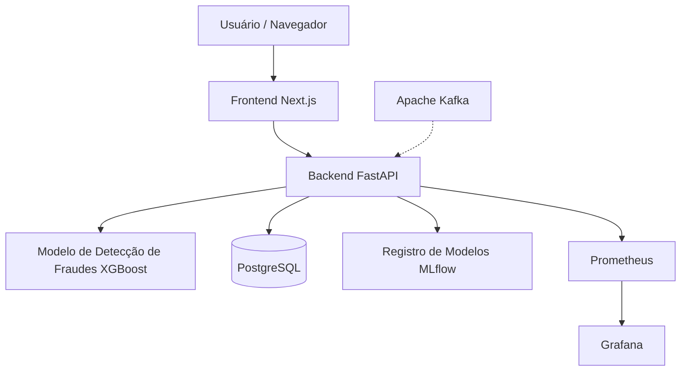

# FraudShield AI

### Sistema de Machine Learning de Ponta a Ponta para Detecção de Fraudes

O FraudShield AI é um projeto full-stack de Machine Learning desenvolvido para identificar transações financeiras potencialmente fraudulentas utilizando um modelo de classificação XGBoost.

O projeto demonstra a integração entre engenharia de Machine Learning, desenvolvimento backend, MLOps, persistência de dados, monitoramento e uma interface web moderna.

A aplicação é executada localmente utilizando Docker Compose, sem necessidade de implantação em nuvem.

## Principais Funcionalidades

- Previsão de fraudes utilizando XGBoost.
- API REST desenvolvida com FastAPI.
- Dashboard interativo desenvolvido com Next.js.
- PostgreSQL para armazenamento persistente de dados.
- Infraestrutura Apache Kafka para processamento orientado a eventos.
- MLflow para rastreamento de experimentos e registro de modelos.
- Prometheus e Grafana para observabilidade.
- Docker Compose para orquestração da infraestrutura local.
- Verificações automatizadas de qualidade utilizando GitHub Actions.
- Pipeline de treinamento e registro automático do modelo de Machine Learning.

## Desempenho do Modelo de Machine Learning

A avaliação final apresentou os seguintes resultados:

| Métrica | Resultado |
|---|---|
| ROC-AUC | 0.9694 |
| Average Precision (PR-AUC) | 0.8398 |
| Precision | 0.8696 |
| Recall | 0.8108 |
| F1-Score | 0.8392 |

Os resultados da avaliação estão armazenados localmente em `artifacts/experiments/final_evaluation.json`.

Essas métricas representam o desempenho do modelo nos dados de teste utilizados no projeto e não devem ser interpretadas como garantias de desempenho em produção.

O arquivo de avaliação é gerado durante o desenvolvimento e não está incluído no repositório, pois o diretório `artifacts/` é ignorado pelo Git.

## Arquitetura do Sistema



O Kafka faz parte da infraestrutura local para processamento orientado a eventos. O diagrama não significa que todas as requisições da API passem pelo Kafka.

## Tecnologias Utilizadas

| Camada | Tecnologias |
|---|---|
| Machine Learning | Python, XGBoost, scikit-learn |
| Backend | FastAPI, SQLAlchemy |
| Frontend | Next.js, React, TypeScript, Tailwind CSS |
| Banco de Dados | PostgreSQL |
| Processamento de Eventos | Apache Kafka |
| Rastreamento de Experimentos | MLflow |
| Monitoramento | Prometheus, Grafana |
| Infraestrutura | Docker, Docker Compose |


## Como Executar o Projeto

### Pré-requisitos

Para executar o FraudShield AI localmente, é necessário ter instalado:

- Git
- Docker Desktop
- Docker Compose
- Python 3.12
- pip

O Docker Desktop deve estar em execução antes de iniciar os serviços.

Os comandos abaixo utilizam Windows PowerShell como referência.

### 1. Clonar o repositório

```powershell
git clone https://github.com/AlissonDiaspi/fraudshield-ai.git
cd fraudshield-ai
```

### 2. Configurar o ambiente Python

Crie um ambiente virtual:

```powershell
py -3.12 -m venv .venv
```

Ative o ambiente:

```powershell
.\.venv\Scripts\Activate.ps1
```

Instale as dependências do projeto:

```powershell
python -m pip install -r requirements.txt
```

Instale também as dependências necessárias ao treinamento e ao registro do modelo, caso ainda não estejam incluídas no arquivo de requisitos:

```powershell
python -m pip install mlflow==3.17.2
```

Os scripts Python devem ser executados a partir da raiz do repositório, com o ambiente virtual ativado.

### 3. Preparar o dataset

O FraudShield AI utiliza o dataset **Credit Card Fraud Detection**, disponibilizado no Kaggle.

Dataset:

https://www.kaggle.com/datasets/mlg-ulb/creditcardfraud

Após o download, extraia o arquivo CSV e coloque-o no seguinte diretório:

```text
data/raw/creditcard.csv
```

A estrutura esperada é:

```text
fraudshield-ai/
├── data/
│   ├── raw/
│   │   └── creditcard.csv
│   └── processed/
├── scripts/
├── src/
├── docker-compose.yml
└── README.md
```

O dataset não é incluído no GitHub devido ao seu tamanho.

### 4. Configurar as variáveis de ambiente

Se o projeto disponibilizar um arquivo `.env.example`, crie uma cópia:

```powershell
Copy-Item .env.example .env
```

Configure as variáveis exigidas pelo `docker-compose.yml`, quando aplicável.

Exemplo de variáveis utilizadas pela infraestrutura:

```env
POSTGRES_USER=fraudshield
POSTGRES_PASSWORD=defina_uma_senha_local
POSTGRES_DB=fraudshield_db
GRAFANA_ADMIN_PASSWORD=defina_outra_senha
```

**Atenção:** os nomes e valores devem corresponder à configuração efetiva do Docker Compose. Caso existam credenciais definidas diretamente no arquivo `docker-compose.yml`, alterá-las apenas no `.env` não modifica esses valores.

O arquivo `.env` não deve ser enviado ao GitHub.

### 5. Iniciar a infraestrutura necessária ao treinamento

Antes de iniciar a API, precisamos disponibilizar o MLflow para registrar o modelo de Machine Learning.

Execute:

```powershell
docker compose up -d --build postgres kafka mlflow
```

Esse comando inicia:

- PostgreSQL
- Apache Kafka
- MLflow

O MLflow ficará disponível em:

http://127.0.0.1:5000

Aguarde os serviços inicializarem antes de prosseguir.

### 6. Treinar e registrar o modelo

Em uma instalação nova, o MLflow ainda não possui um modelo registrado com o alias `champion`.

O FraudShield AI disponibiliza um script de bootstrap responsável por:

1. Verificar se já existe um modelo `champion`.
2. Treinar um modelo XGBoost quando necessário.
3. Registrar o experimento no MLflow.
4. Criar uma versão no Model Registry.
5. Definir o alias `champion`.

Configure o endereço do MLflow no PowerShell:

```powershell
$env:MLFLOW_TRACKING_URI = "http://127.0.0.1:5000"
```

Execute o bootstrap:

```powershell
python -m scripts.bootstrap_model
```

Na primeira execução, o treinamento será realizado e o modelo será registrado automaticamente.

Nas próximas execuções, caso o `champion` já exista, o script não realizará um novo treinamento.

Para forçar um novo treinamento e registrar outra versão, existe a opção:

```powershell
python -m scripts.bootstrap_model --force
```

**Atenção:** a opção `--force` cria uma nova versão e atualiza o alias `champion`. Utilize-a somente quando desejar substituir o modelo principal por uma nova versão.

Após a conclusão, o modelo poderá ser visualizado no MLflow Model Registry.

### 7. Iniciar a aplicação completa

Depois que o modelo `champion` estiver registrado, execute:

```powershell
docker compose up -d --build
```

Esse comando inicia os serviços configurados no Docker Compose, incluindo a API, o frontend e os componentes de monitoramento.

A API FastAPI carrega o modelo registrado no MLflow durante sua inicialização.

Por isso, o bootstrap deve ser executado antes de iniciar a API em uma instalação nova.

### 8. Verificar a aplicação

Para conferir os contêineres:

```powershell
docker compose ps
```

Para verificar a integridade da API:

```powershell
Invoke-RestMethod http://127.0.0.1:8000/health
```

A API deverá responder com informações sobre seu estado de funcionamento.

### 9. Acessar os serviços

| Serviço | Endereço Local |
|---|---|
| Frontend | http://127.0.0.1:3001 |
| FastAPI Swagger | http://127.0.0.1:8000/docs |
| FastAPI Health | http://127.0.0.1:8000/health |
| MLflow | http://127.0.0.1:5000 |
| Prometheus | http://127.0.0.1:9090 |
| Grafana | http://127.0.0.1:3000 |

### 10. Encerrar a aplicação

Para parar e remover os contêineres da aplicação:

```powershell
docker compose down
```

Os volumes persistentes do Docker são mantidos por padrão.

Para iniciar novamente:

```powershell
docker compose up -d
```

Em um ambiente já configurado, com o modelo `champion` registrado, não é necessário executar o bootstrap a cada inicialização.

**Importante:** evite utilizar `docker compose down -v` caso queira preservar os dados armazenados nos volumes Docker.

## Registro de Modelos

O FraudShield AI utiliza o MLflow para gerenciar diferentes versões dos modelos de Machine Learning.

A configuração de referência utilizada no desenvolvimento é:

- **Nome do modelo:** `FraudShield-FraudDetector`
- **Versão inicial:** `1`
- **Alias:** `champion`
- **Algoritmo:** XGBoost

A versão registrada pode variar conforme novos treinamentos sejam realizados.

A API consulta o Model Registry e carrega a versão associada ao alias `champion`.

O modelo é carregado durante a inicialização da API, permitindo que as previsões utilizem uma versão registrada e identificável.

O treinamento e o registro também podem ser executados separadamente por meio dos scripts disponíveis no diretório `scripts/`.

## API

A aplicação FastAPI disponibiliza endpoints para:

- Verificação de integridade do sistema.
- Previsão de fraudes.
- Consulta ao histórico de transações.
- Estatísticas relacionadas às previsões.

A documentação interativa da API está disponível por meio do Swagger UI:

http://127.0.0.1:8000/docs

## Persistência de Dados

O PostgreSQL é utilizado para armazenar os dados persistentes da aplicação, incluindo o histórico das previsões.

Os dados são mantidos no armazenamento persistente configurado no Docker Compose.

Isso permite reiniciar ou reconstruir os contêineres sem necessariamente perder as transações registradas, desde que o armazenamento persistente original seja preservado.

O MLflow também utiliza armazenamento persistente para seus metadados e artefatos de modelos.

Os arquivos locais do MLflow e os datasets não são versionados no GitHub.

## Monitoramento e Observabilidade

O Prometheus coleta métricas de monitoramento disponibilizadas pelos serviços configurados, enquanto o Grafana oferece dashboards para acompanhar o comportamento do sistema.

O projeto também utiliza o MLflow para rastrear experimentos de Machine Learning e gerenciar versões dos modelos.

As ferramentas de observabilidade podem ser acessadas pelos endereços locais apresentados na seção de execução.

## Integração Contínua

O projeto utiliza GitHub Actions para executar verificações automatizadas de qualidade do código.

Os workflows estão disponíveis no diretório:

```text
.github/workflows/
```

Essas verificações auxiliam na identificação de problemas durante a evolução do projeto.

## Escopo do Projeto

O FraudShield AI é um projeto local, educacional e voltado para portfólio, desenvolvido para demonstrar conhecimentos e práticas de engenharia de Machine Learning.

A aplicação não foi projetada para tomar decisões financeiras reais sem validações adicionais, controles de segurança, governança de modelos e monitoramento em produção.


## Autor

**Alisson Dias Pinheiro**

Graduando em Ciência da Computação | Machine Learning & AI Engineering

GitHub: https://github.com/AlissonDiaspi
